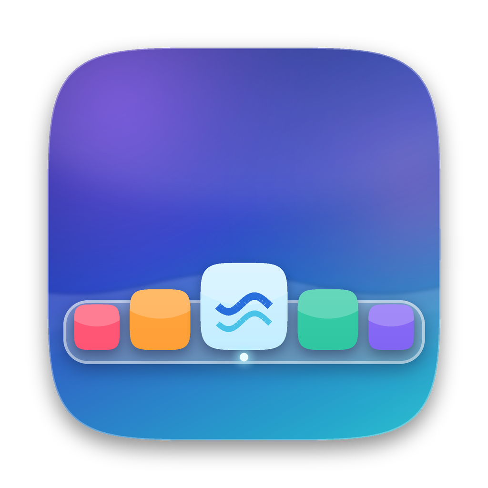
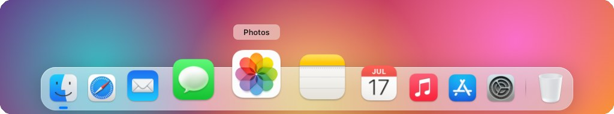
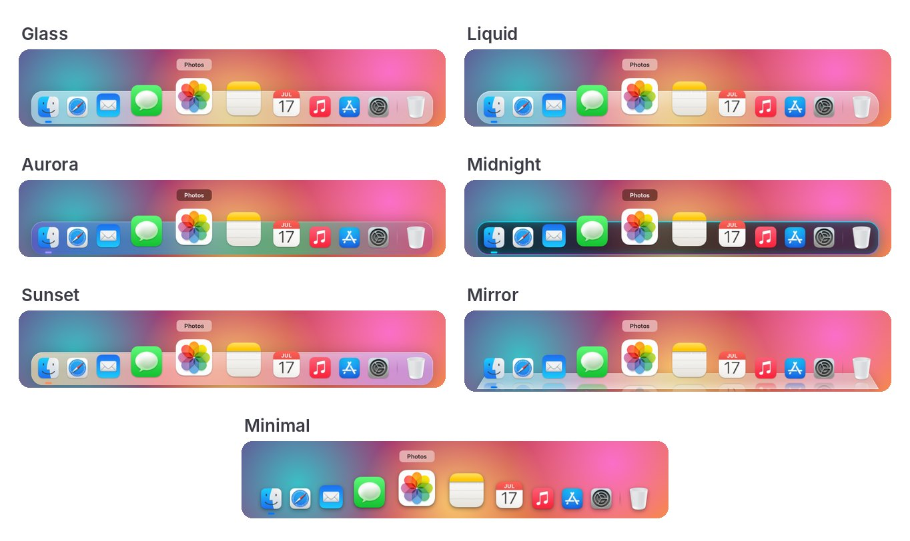
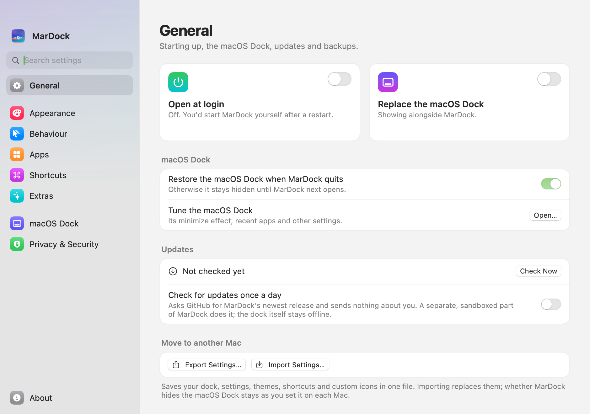
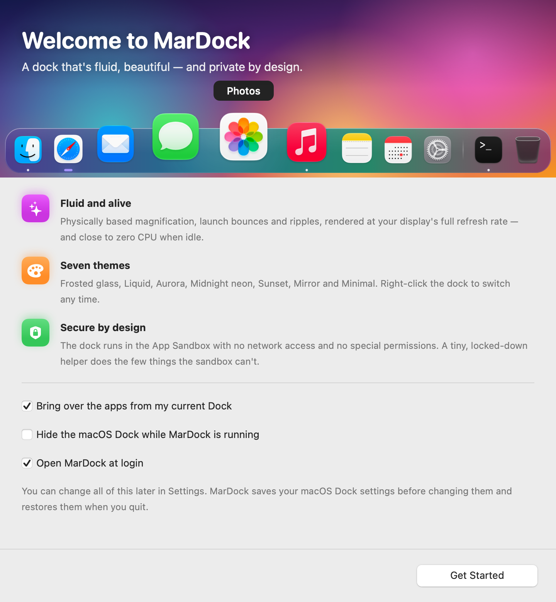

<p align="center">
  
</p>

<h1 align="center">MarDock</h1>

<p align="center">
  A dock for macOS that's fluid, beautiful — and private by design.
</p>

<p align="center">
  <a href="https://github.com/ALIRAZA47/mardock/actions/workflows/ci.yml"></a>
  <a href="https://github.com/ALIRAZA47/mardock/releases/latest"></a>
  <a href="LICENSE"></a>
</p>

<p align="center">
  
</p>

MarDock replaces (or sits alongside) the macOS Dock with a dock that moves like
it's made of something real: physically based magnification, launch bounces,
ripples, a puff of smoke when you drag an app away, and seven themes from
frosted glass to aurora and neon. The dock runs in the App Sandbox with no
network access and asks for no special permissions unless you turn on an extra
that needs one.

**[Read the docs](https://mardock.alirazakhan.me/docs/)** or
**[try it in your browser](https://mardock.alirazakhan.me/demo/)** at
[mardock.alirazakhan.me](https://mardock.alirazakhan.me).

## Highlights

**Motion**
- **Magnification that stays under your pointer.** Instead of scaling icons and
  re-centring the row (which makes the icon you're aiming at slide away), MarDock
  warps the dock's axis around the pointer, so whatever is under it stays under it.
- **Real spring physics** for everything — magnification, icons arriving and
  leaving, presses, auto-hide — solved in closed form so it's smooth at any
  refresh rate, including 120 Hz ProMotion.
- **Launch bounces** with a touch of squash and stretch, **click ripples**, a
  **poof** when you drag an app off, a **specular highlight** that follows your
  pointer across the glass, and drifting **aurora** colours.
- **Practically no CPU when idle.** Animation runs off the display's refresh
  only while something moves; ambient effects run in the system's render
  server.

**Looks**
- Seven themes: **Glass**, **Liquid** (real Liquid Glass on macOS 26),
  **Aurora**, **Midnight**, **Sunset**, **Mirror** (glossy floor with
  reflections) and **Minimal**.
- Accent colours, running-indicator styles (glow, dots, lines), optional
  reflections, adjustable icon size, magnification and reach.

**Your dock, your way**
- **Theme editor**: start from any theme and change the glass, tint, drifting
  colours, edge, neon glow, shadows and accent with a live preview. Themes are
  small files you can share.
- **Folder stacks**: keep a folder in the dock; its tile shows the newest
  files and a click fans them out (or shows a grid).
- **Profiles** such as Work and Personal, each with its own apps and items,
  switched from the dock's menu or Settings.
- **Spacers and named dividers** to group apps, a **Share tile** to drop files
  on, a **recent apps** section and **custom icons** for any app.
- **Double-click shortcuts**: double-click an app for a small panel with its
  own New and Open commands and their keyboard shortcuts (with Accessibility),
  websites, files and Shortcuts you add for it, and Hide, Hide Others, Show in
  Finder and Quit. Or have a double-click hide the app, or hide the others.
- **Keyboard launching**: ⌃⌥1–9 opens the first nine apps (or ⌥ / ⌥⌘).
- **Shortcuts, Siri and Focus**: actions to switch profiles and set the theme,
  position, hiding and magnification, plus a Focus filter, so a Work Focus can
  bring up your Work dock.
- **Move to another Mac**: export the dock, settings, themes, profiles,
  shortcuts and icons to one file and import it there.
- **Extras you can turn on**: notification badges and minimized windows by
  the Trash (with Accessibility), window previews on hover (with Screen
  Recording) and a full Trash icon. All off until you switch them on.
- **Empty Trash** from the Trash's menu (hold ⌥ to skip the question), done by
  Finder just as the macOS Dock does it.
- **Updates when you want them**: Check for Updates in the menu bar menu or
  Settings ▸ About, or a daily check you can turn on. Installing downloads the
  release, checks it against its published checksum and its signature, swaps
  it in and relaunches.

**Behaviour**
- Bottom, left or right; main display or follow the pointer between displays.
- Auto-hide: never, always, or **only when a window overlaps the dock**.
- Drag apps from Finder to add them, drag icons to reorder, drag off to remove,
  drop documents on an app to open them with it.
- Right-click an app for its Shortcuts, Show/Hide/Quit/Force Quit (hold ⌥),
  Keep in Dock, Show in Finder. Right-click the dock for themes, position and
  hiding.
  ⌘-click reveals an app in Finder; ⌥-click hides it.
- Optionally hides the macOS Dock while MarDock runs, saving your settings first
  and restoring them when MarDock quits. It stays hidden when an app bounces
  for attention and when the pointer pushes against another display's edge.
- Opens at login, from Settings ▸ General or the menu bar menu.
- Also tunes the **macOS Dock** itself: minimize effect, auto-hide delay and
  animation speed, recent apps, translucent hidden apps and more.

**Accessibility**
- VoiceOver can explore and press every dock item.
- Respects Reduce Motion (no bounces or particles), Reduce Transparency and
  Increase Contrast.

## Themes

<p align="center">
  
</p>

<table>
  <tr>
    <td></td>
    <td></td>
  </tr>
  <tr>
    <td align="center">Settings, with a live preview you can play with</td>
    <td align="center">First-run welcome</td>
  </tr>
</table>

<sub>Screenshots are taken automatically by CI on a macOS 15 runner (over a test
backdrop), and every run also records the real app touring the dock (the
**tour-video** artifact). On macOS 26 the Liquid theme uses the system's real
Liquid Glass.</sub>

## Security and privacy

| | |
| --- | --- |
| 🔒 **App Sandbox** | The dock runs sandboxed: it can't read your files or other apps' data. |
| 🌐 **An offline dock** | The dock has no network entitlement, so macOS blocks every connection. No analytics, ever. Update checks run only when you ask (or turn on the daily check), in a separate sandboxed updater that can fetch this repository's GitHub releases and nothing else. |
| 🛡 **Hardened Runtime** | On every executable, with no exceptions: no code injection, no unsigned libraries. |
| 🧩 **Tiny, locked-down helper** | Quitting or hiding apps and changing the macOS Dock need more than the sandbox allows, so a small XPC helper does exactly that — a handful of allowlisted operations, strictly validated, and it only accepts connections from the exact app it ships in. |
| 🙅 **No special permissions by default** | Accessibility and Screen Recording only if you turn on the extras that need them; Automation for Finder only when you first choose Empty Trash (the sandbox allows that one command); never Input Monitoring or Full Disk Access. |
| 📦 **No dependencies** | Pure Swift, AppKit and Core Animation. No third-party code. |
| ✅ **Verified, not just claimed** | `make audit` checks entitlements, signatures, imported APIs and the sources for anything looked up by name; `make selftest` proves the sandbox blocks the dock's network and the helper refuses what it should, junk updates included. Both run in CI. |

Details: [SECURITY.md](SECURITY.md) · [PRIVACY.md](PRIVACY.md)

## Requirements

- macOS 14 Sonoma or later (Apple silicon or Intel).
- To build: Xcode 15 or later (Xcode 26 recommended for Liquid Glass), or just
  the Command Line Tools (`xcode-select --install`) for a build for your Mac's
  architecture.

## Download

Get the disk image from [Releases](https://github.com/ALIRAZA47/mardock/releases),
open it and drag MarDock to Applications. Each release lists SHA-256
checksums; check a download with `shasum -a 256 -c SHA256SUMS.txt --ignore-missing`.

Releases are signed ad-hoc and not notarized unless the repository's signing
secrets are set up (then they are signed with a Developer ID, notarized by
Apple, and carry a build provenance you can check with
`gh attestation verify MarDock-<version>.dmg --repo ALIRAZA47/mardock`).
The first time you open an ad-hoc build, macOS says it can't verify MarDock:
click **Done**, open System Settings ▸ Privacy & Security, scroll down to the
notice about MarDock and click **Open Anyway** — once. Or clear the download
flag first with `xattr -dr com.apple.quarantine /Applications/MarDock.app`.

## Build and run

```sh
git clone https://github.com/ALIRAZA47/mardock.git
cd mardock
make install    # builds, copies to /Applications and opens MarDock
```

or `make run` to build and launch from `build/MarDock.app` without installing.

On first launch MarDock offers to bring over the apps from your current Dock,
hide the macOS Dock while it runs, and open at login. MarDock lives in the menu
bar (the dock icon) — that's where Settings and Quit are.

Other tasks:

```sh
make playground # try the dock in your browser before building
make test       # unit tests (engine, validation, protocol)
make audit      # security audit of the built app
make selftest   # end-to-end checks against your system
make clean
```

### Using the build from CI

Every CI run uploads a zipped `MarDock.app` (the **MarDock-app** artifact);
take one from a run on `main`, since a pull request's run builds that pull
request's code. It is signed ad-hoc, not notarized, so it needs the same
one-time **Open Anyway** step as an ad-hoc release (see Download above), or
`xattr -dr com.apple.quarantine MarDock.app`. Building it yourself avoids this.

### Signing for distribution

Local builds are signed ad-hoc, which is fine on the Mac that built them. To
share MarDock, sign it with a Developer ID and notarize it:

```sh
SIGN_IDENTITY="Developer ID Application: Your Name (TEAMID)" make app
ditto -c -k --keepParent build/MarDock.app build/MarDock.zip
xcrun notarytool submit build/MarDock.zip --keychain-profile <profile> --wait
xcrun stapler staple build/MarDock.app
make dmg        # build/MarDock.dmg, signed when SIGN_IDENTITY is set
```

### Releases

Pushing a tag such as `v1.0.0` runs the **Release** workflow: it builds the
universal app, runs the security audit, signs and notarizes it, packs a disk
image and a zip with their checksums, records build provenance and publishes
them as a GitHub release. Run it by hand from the Actions tab for a test
build (uploaded as an artifact, nothing published).

Without secrets the release is signed ad-hoc and says so. To sign and
notarize, add these repository secrets (Settings ▸ Secrets and variables ▸
Actions):

| Secret | What |
| --- | --- |
| `MACOS_CERTIFICATE` | Your **Developer ID Application** certificate and key, exported from Keychain Access as .p12, then `base64 -i cert.p12` |
| `MACOS_CERTIFICATE_PASSWORD` | The password you gave the .p12 |
| `MACOS_SIGN_IDENTITY` | Its name, e.g. `Developer ID Application: Your Name (TEAMID)` |
| `NOTARY_API_KEY`, `NOTARY_API_KEY_ID`, `NOTARY_API_ISSUER` | An App Store Connect API key (`base64 -i AuthKey_XXXX.p8`), its key ID and issuer ID |
| or `NOTARY_APPLE_ID`, `NOTARY_TEAM_ID`, `NOTARY_PASSWORD` | Your Apple ID, team ID and an app-specific password |

## Getting the macOS Dock back

Turn off **Settings ▸ General ▸ Replace the macOS Dock**, choose **Restore
the macOS Dock** in the menu bar menu, or just quit MarDock. If MarDock ever
can't (say, after a crash), run:

```sh
defaults delete com.apple.dock autohide-delay
defaults delete com.apple.dock no-bouncing
defaults delete com.apple.dock allow-display-switching
defaults write com.apple.dock autohide -bool false
killall Dock
```

## How it's built

```
Sources/
  MarDockCore/    Pure Swift: spring physics, the magnification warp, layout and
                  hit-testing engine, auto-hide logic, validated settings, the
                  helper protocol. Unit-tested (also builds on Linux).
  MarDock/        The sandboxed app: Core Animation renderer (Dock/), app state
                  (Model/), helper client and actions (Services/), SwiftUI
                  settings and onboarding (UI/).
  MarDockAgent/   The XPC helper.
App/              Info.plists, entitlements, icon.
scripts/          Bundle + sign, security audit, self-test, icon generator.
site/             The website and docs, built with python3 site/build.py.
```

[`playground/index.html`](playground/index.html) is a browser version of the
dock for trying looks and settings without building: it runs a line-for-line
port of the engine and the themes' numbers, so keep it in step with
`MarDockCore` and `Theme.swift`. Only the frosted glass and the app icons are stand-ins.
It's also the website's live demo.

The interesting part is [`DockEngine`](Sources/MarDockCore/DockEngine.swift): it
owns every spring and produces one `DockFrame` per display refresh, which
[`DockView`](Sources/MarDock/Dock/DockView.swift) maps onto layers. The
magnification math is in [`Magnifier`](Sources/MarDockCore/Magnifier.swift).

## Limitations

- No notification badges on icons: reading them would need Accessibility
  access to the system Dock, which MarDock deliberately doesn't ask for.
- Minimized windows still go to the (hidden) macOS Dock. Turn on **Minimize
  windows into their app's icon** (Settings ▸ macOS Dock) and click the app to
  bring them back.
- macOS doesn't let third-party apps reserve screen space the way the system
  Dock does, so maximised windows can extend under MarDock. Use
  “Automatically hide ▸ When a window overlaps”.

## Contributing

Bug reports, ideas and pull requests are welcome.
[CONTRIBUTING.md](CONTRIBUTING.md) explains how to build and check a change
and what keeps the security model intact, and [CHANGELOG.md](CHANGELOG.md)
lists what has changed. Security problems go through
[private vulnerability reporting](https://github.com/ALIRAZA47/mardock/security/advisories/new)
rather than issues. This project follows the
[Contributor Covenant](CODE_OF_CONDUCT.md).

## License

MarDock is released under the [MIT License](LICENSE).
